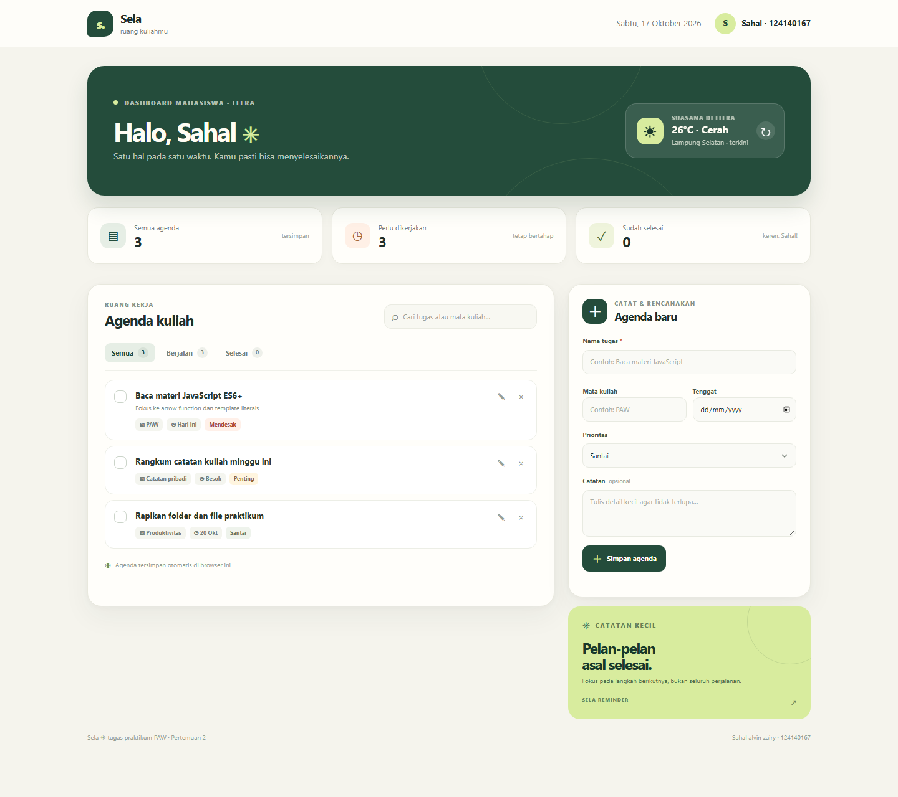

# Sela — Ruang Kuliah

## Identitas
- **Nama:** Sahal alvin zairy
- **NIM:** 124140167
- **Kelas Praktikum:** RA
- **Pertemuan:** 2 — JavaScript Next Gen (ES6+)

## Deskripsi
**Sela** adalah dashboard personal untuk membantu mahasiswa ITERA mengatur
agenda kuliah, tugas, dan kebiasaan belajar dalam satu tempat. Setiap agenda
bisa ditambah, diedit, ditandai selesai, dicari, difilter, dan dihapus.

Tenggat, mata kuliah, tingkat prioritas, dan catatan singkat membantu
menentukan langkah berikutnya. Ringkasan agenda diperbarui otomatis dan data
disimpan di `localStorage`, sehingga tetap tersedia saat halaman dibuka ulang
di browser yang sama. Widget cuaca Lampung Selatan mengambil kondisi terkini
dari Open-Meteo; fitur pengelolaan agenda tetap dapat digunakan tanpa internet.

## Menjalankan Aplikasi
Aplikasi tidak memerlukan build tool atau instalasi dependency.

1. Buka `index.html` langsung di browser, atau gunakan ekstensi Live Server.
2. Pada kunjungan pertama, Sela menampilkan tiga contoh agenda yang dapat
diedit atau dihapus. Agenda berikutnya disimpan otomatis di browser.
3. Koneksi internet diperlukan hanya untuk memuat widget cuaca Open-Meteo.

## Fitur
- [x] Tambah agenda dengan nama, mata kuliah, tenggat, prioritas, dan catatan.
- [x] Edit agenda yang sudah dibuat dan batalkan mode edit.
- [x] Tandai agenda selesai atau aktif kembali.
- [x] Hapus agenda dengan konfirmasi.
- [x] Cari agenda berdasarkan nama, mata kuliah, atau catatan.
- [x] Filter semua agenda, yang berjalan, dan yang selesai.
- [x] Ringkasan jumlah agenda diperbarui otomatis.
- [x] Penanda tenggat hari ini, besok, dan agenda yang terlambat.
- [x] Penyimpanan lokal memakai `localStorage` dan validasi data saat dimuat.
- [x] Cuaca terkini ITERA dari Open-Meteo dengan penanganan saat gagal dimuat.
- [x] Tampilan responsif, validasi form HTML, dan empty state.

## Tangkapan Layar



## Fitur ES6+ dan Lokasi Implementasi
Baris merujuk ke `script.js`.

| Fitur | Lokasi | Penggunaan |
| --- | --- | --- |
| `const` dan `let` | 1–42, 319–323 | Konstanta, fungsi bantu, dan label tanggal yang nilainya ditentukan ulang. |
| Arrow functions | 25–42, 129–165, 351–361 | Fungsi bantu, event handler, dan callback array. |
| Template literals | 26, 224, 289–310 | Pesan konfirmasi dan template HTML agenda. |
| Classes | 44–73, 75–349 | `TaskItem` memodelkan data; `DashboardApp` mengelola state, DOM, dan penyimpanan. |
| Destructuring | 67, 171, 336 | Membaca properti task, form, dan respons cuaca. |
| Spread operator | 176–190 | Membuat task baru saat mengedit atau mengubah status tanpa memutasi item lama. |
| Array methods | 109, 137, 176–190, 238–249 | `map`, `filter`, `find`, `forEach`, dan `sort` untuk mengelola state. |
| Async/await dan `fetch` | 326–349 | Memuat cuaca Open-Meteo secara asinkron dan menangani kegagalan jaringan. |
| `localStorage` | 96–123 | Membaca serta menyimpan daftar agenda sebagai JSON. |

## Struktur Folder

```text
sahalalvinzairy_124140167_pertemuan2/
├── index.html
├── style.css
├── script.js
├── README.md
└── screenshot-dashboard.png
```
