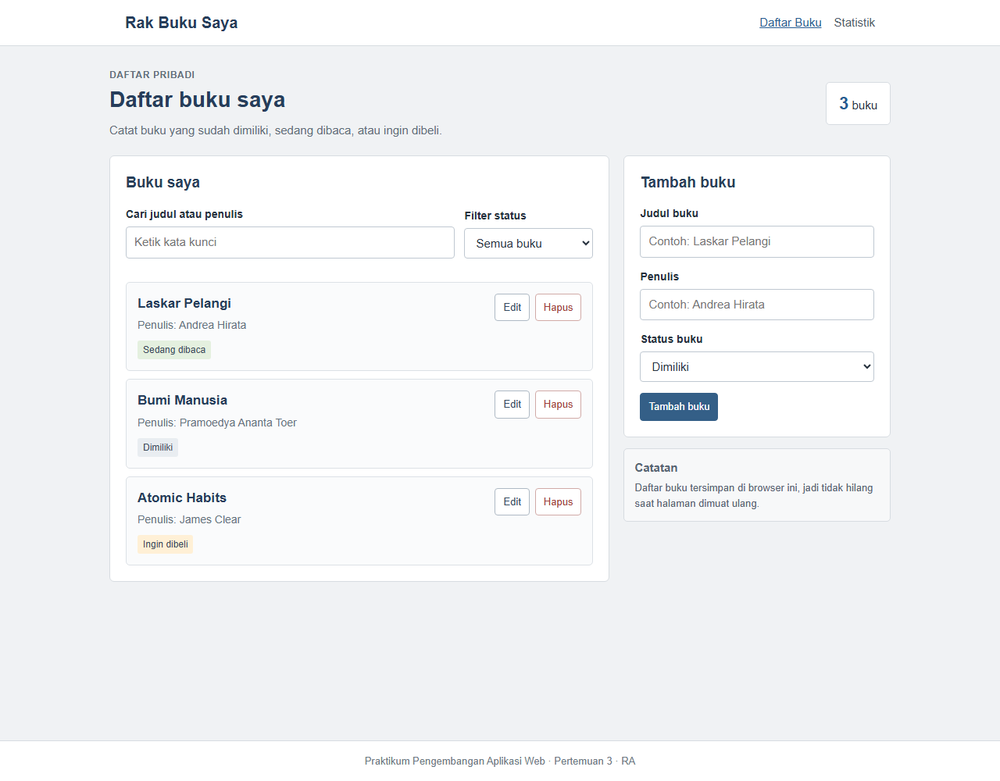

# Rak Buku Saya

## Identitas
- **Nama:** Sahal alvin zairy
- **NIM:** 124140167
- **Kelas Praktikum:** RA
- **Pertemuan:** 3 — React Basics

## Deskripsi
Aplikasi sederhana untuk mencatat buku yang sudah dimiliki, sedang dibaca,
atau ingin dibeli. Pengguna dapat menambah, mengubah, menghapus, mencari, dan
memfilter buku. Data disimpan di `localStorage` browser.

Tampilan sengaja dibuat sederhana agar fokus pada latihan React dan mudah
dipelajari. Data buku contoh pada screenshot hanya untuk menunjukkan tampilan;
aplikasi baru dibuka dengan daftar kosong.

## Cara Menjalankan
Pastikan Node.js sudah terpasang, lalu jalankan perintah berikut dari folder
proyek:

```bash
npm install
npm run dev
```

Buka URL lokal yang ditampilkan Vite di terminal. Untuk menjalankan pengujian:

```bash
npm run test:run
```

Untuk memeriksa build production dan lint:

```bash
npm run build
npm run lint
```

## Fitur
- Menambahkan buku dengan judul, penulis, dan status.
- Mengedit informasi buku yang sudah dicatat.
- Menghapus buku dengan konfirmasi.
- Mencari berdasarkan judul atau penulis.
- Memfilter berdasarkan status: dimiliki, sedang dibaca, dan ingin dibeli.
- Membuka halaman statistik melalui React Router.
- Menyimpan daftar buku otomatis di `localStorage`.
- Menampilkan pesan validasi jika judul atau penulis belum diisi.

## Screenshot



## Konsep React yang Digunakan
- Functional components dan `useState` untuk form, pencarian, filter, dan pesan.
- `useEffect` pada custom hook `useLocalStorage` untuk menyimpan data.
- Context API (`BookContext`) untuk membagikan data dan operasi buku.
- React Router untuk halaman daftar buku dan statistik.
- Custom hooks `useLocalStorage` dan `useBookStats`.
- Komponen reusable: `BookForm`, `BookFilter`, `BookList`, `BookItem`, dan `StatCard`.
- PropTypes untuk memeriksa props pada komponen.

## Hasil Pengujian

Pengujian dijalankan dengan `npm run test:run` menggunakan Vitest dan React
Testing Library.

```text
Test Files  2 passed (2)
Tests       7 passed (7)
```

Test mencakup validasi form, penambahan dan penyimpanan, pencarian, filter,
pengeditan, dan penghapusan buku. `npm run build` dan `npm run lint` juga
berhasil tanpa peringatan.

## Struktur Folder

```text
sahalalvinzairy_124140167_pertemuan3/
├── src/
│   ├── components/
│   ├── context/
│   ├── hooks/
│   ├── pages/
│   ├── test/
│   ├── App.jsx
│   └── main.jsx
├── index.html
├── package.json
└── README.md
```
