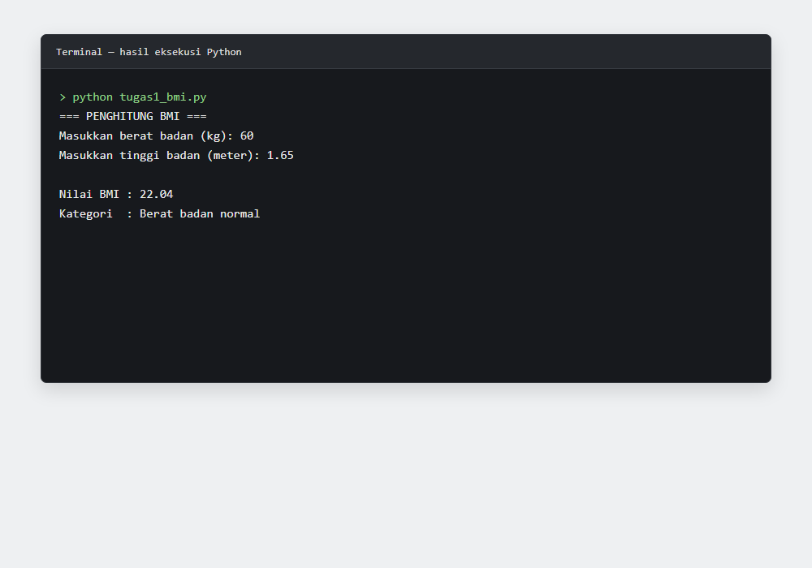
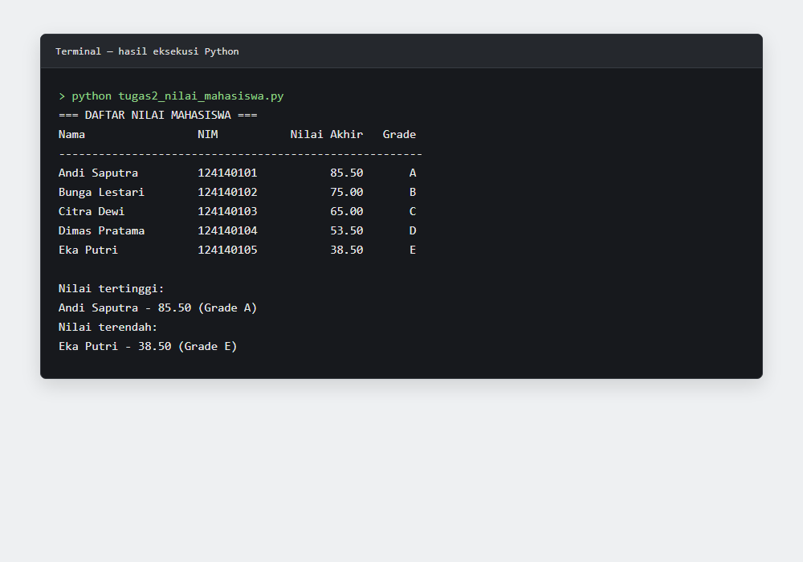
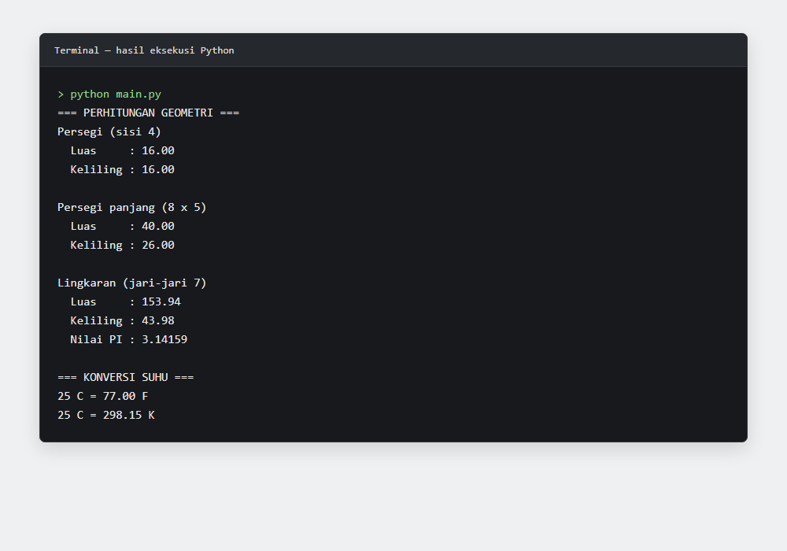

# Tugas Praktikum Pertemuan 4 — Dasar Pemrograman Python

## Identitas
- **Nama:** Sahal alvin zairy
- **NIM:** 124140167
- **Kelas Praktikum:** RA

## Deskripsi
Folder ini berisi tiga latihan dasar Python:

1. `tugas1_bmi.py` menerima berat dan tinggi, menghitung BMI, lalu menampilkan kategori.
2. `tugas2_nilai_mahasiswa.py` menyimpan lima data mahasiswa, menghitung nilai akhir berbobot, menampilkan tabel nilai, serta mencari nilai tertinggi dan terendah.
3. `math_operations.py` berisi konstanta PI, fungsi luas dan keliling persegi, persegi panjang, dan lingkaran, serta fungsi konversi suhu. `main.py` menjalankan semua fungsi dengan dua cara impor.

## Cara Menjalankan
Pastikan Python 3 sudah terpasang. Buka terminal di folder ini, lalu jalankan:

```bash
python tugas1_bmi.py
python tugas2_nilai_mahasiswa.py
python main.py
```

Pada program BMI, masukkan berat dalam kilogram dan tinggi dalam meter saat diminta.

## Screenshot Hasil Program

### 1. Penghitung BMI


### 2. Nilai mahasiswa


### 3. Modul matematika


## Konsep Python yang Digunakan
- Variabel, input, konversi tipe data, dan f-string.
- Percabangan `if` untuk kategori BMI dan grade.
- List berisi dictionary, perulangan, `max()`, dan `min()`.
- Fungsi dengan docstring.
- Modul dan dua bentuk impor: `import math_operations` serta `from math_operations import ...`.

Semua program hanya menggunakan pustaka standar Python.
