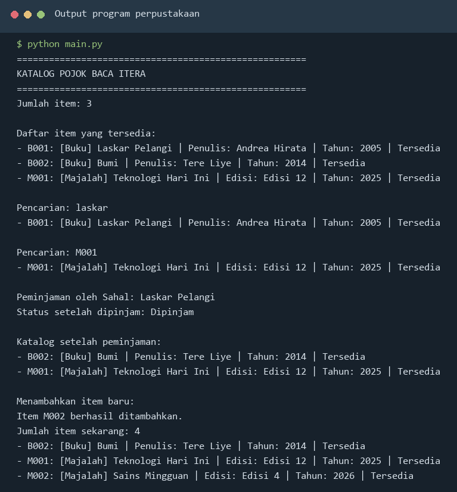

# Pertemuan 5 — Sistem Manajemen Perpustakaan

## Identitas Mahasiswa
- **Nama:** Sahal alvin zairy
- **NIM:** 124140167
- **Kelas Praktikum:** RA

## Deskripsi Program
Program terminal ini mengelola buku dan majalah di perpustakaan. Program menampilkan katalog item tersedia, mencari item berdasarkan judul atau ID, meminjam item, dan menambahkan item baru.

### Penerapan OOP
- **Class dan object:** `Library`, `Book`, `Magazine`, dan `Member` menjadi cetakan untuk membuat object.
- **Inheritance:** `Book` dan `Magazine` mewarisi atribut serta perilaku umum dari `LibraryItem`.
- **Encapsulation:** atribut koleksi pada `Library` dibuat private (`__koleksi`). Atribut status item memakai protected (`_is_borrowed`) dan dapat dibaca melalui property `is_available`.
- **Polymorphism dan abstract class:** `LibraryItem` mewajibkan subclass membuat method `get_detail()`. Saat katalog memanggil method yang sama, tiap jenis item menampilkan informasi sesuai class-nya.

## Struktur Folder
```text
latihan/                 Contoh materi OOP

tugas_perpustakaan/      Program utama perpustakaan
  library_item.py        Abstract class, Book, dan Magazine
  library.py             Pengelolaan katalog dan pencarian
  member.py              Data anggota
  main.py                Contoh penggunaan program
```

## Cara Menjalankan
Gunakan Python 3. Buka terminal dari folder `sahalalvinzairy_124140167_pertemuan5/tugas_perpustakaan`, lalu jalankan:

```bash
python main.py
```

## Screenshot Output Terminal
Screenshot berikut menunjukkan katalog tersedia, pencarian judul dan ID, perubahan status setelah peminjaman, dan penambahan item.



## Menjalankan Latihan
Dari folder `sahalalvinzairy_124140167_pertemuan5/latihan`, jalankan salah satu file, contohnya:

```bash
python 06_abstract_class.py
```
