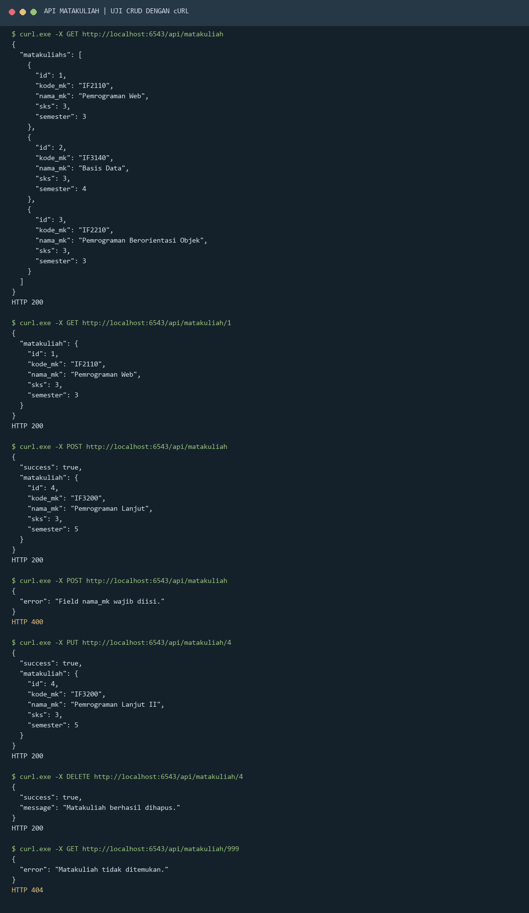
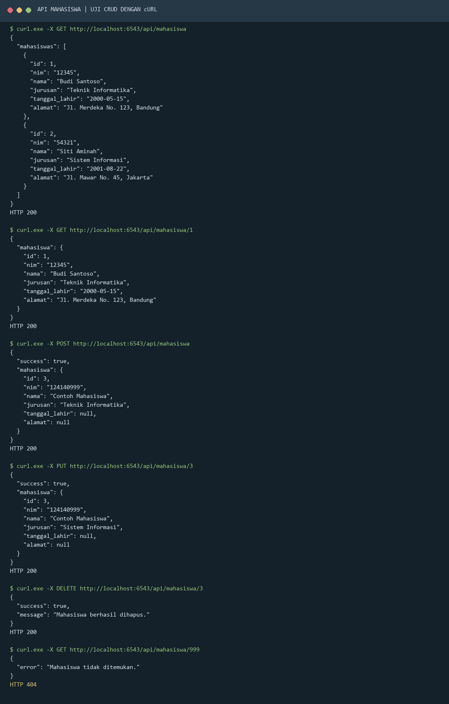

# Pertemuan 6 — REST API Manajemen Matakuliah

## Identitas
- **Nama:** Sahal alvin zairy
- **NIM:** 124140167
- **Kelas Praktikum:** RA

## Deskripsi
Proyek ini menggunakan Pyramid, SQLAlchemy, dan Alembic untuk membuat REST API data mahasiswa dan matakuliah. Kedua resource memiliki endpoint CRUD, validasi input, serta respons JSON untuk data yang tidak ditemukan atau tidak valid.

## Struktur Folder
```text
development.ini                 Konfigurasi PostgreSQL
production.ini                  Konfigurasi server production
development-sqlite.ini          Konfigurasi SQLite untuk uji lokal
pyramid_mahasiswa/
  models/                       Model Mahasiswa dan Matakuliah
  views/                        Controller API
  scripts/initialize_db.py      Pembuatan data awal
  alembic/versions/             Riwayat migrasi database
  tests/test_api.py             Pengujian endpoint
```

## Instalasi
Pastikan Python 3.10+ dan PostgreSQL tersedia. Dari folder tugas, buat dan aktifkan virtual environment, lalu pasang dependensi:

```powershell
python -m venv .venv
.venv\Scripts\Activate.ps1
pip install -e ".[testing]"
```

Buat database, user, dan izin skema di PostgreSQL (sesuaikan jika username/password yang dipakai berbeda):

```sql
CREATE DATABASE pyramid_mahasiswa;
CREATE USER pyramid_user WITH ENCRYPTED PASSWORD 'pyramid_pass';
GRANT ALL PRIVILEGES ON DATABASE pyramid_mahasiswa TO pyramid_user;
\c pyramid_mahasiswa
GRANT ALL ON SCHEMA public TO pyramid_user;
```

Jalankan migrasi, isi data awal, lalu mulai server:

```powershell
alembic -c development.ini upgrade head
python -m pyramid_mahasiswa.scripts.initialize_db development.ini
pserve development.ini --reload
```

Server berjalan di `http://localhost:6543`. Apabila PostgreSQL belum terpasang, gunakan konfigurasi SQLite untuk mencoba endpoint secara lokal:

```powershell
alembic -c development-sqlite.ini upgrade head
python -m pyramid_mahasiswa.scripts.initialize_db development-sqlite.ini
pserve development-sqlite.ini --reload
```

## Endpoint

| Method | Endpoint | Fungsi |
| --- | --- | --- |
| GET | `/api/matakuliah` | Daftar matakuliah |
| GET | `/api/matakuliah/{id}` | Detail matakuliah |
| POST | `/api/matakuliah` | Tambah matakuliah |
| PUT | `/api/matakuliah/{id}` | Ubah matakuliah |
| DELETE | `/api/matakuliah/{id}` | Hapus matakuliah |
| GET | `/api/mahasiswa` | Daftar mahasiswa; `?q=` untuk mencari nama/NIM |
| GET | `/api/mahasiswa/{id}` | Detail mahasiswa |
| POST | `/api/mahasiswa` | Tambah mahasiswa |
| PUT | `/api/mahasiswa/{id}` | Ubah mahasiswa |
| DELETE | `/api/mahasiswa/{id}` | Hapus mahasiswa |

### Contoh Pengujian dengan cURL
Jalankan perintah dari terminal lain saat server aktif. Contoh berikut memakai PowerShell dan `curl.exe`:

```powershell
curl.exe http://localhost:6543/api/matakuliah
curl.exe http://localhost:6543/api/matakuliah/1
curl.exe -X POST http://localhost:6543/api/matakuliah -H "Content-Type: application/json" -d '{"kode_mk":"IF3200","nama_mk":"Pemrograman Lanjut","sks":3,"semester":5}'
curl.exe -X POST http://localhost:6543/api/matakuliah -H "Content-Type: application/json" -d '{"kode_mk":"IF3201"}'
curl.exe -X PUT http://localhost:6543/api/matakuliah/1 -H "Content-Type: application/json" -d '{"nama_mk":"Pemrograman Web Lanjut"}'
curl.exe -X DELETE http://localhost:6543/api/matakuliah/1
curl.exe http://localhost:6543/api/matakuliah/999
```

Contoh ini mencakup operasi CRUD, validasi field wajib (400), serta ID yang tidak ditemukan (404). Semua nilai `sks` dan `semester` harus integer lebih dari nol. `kode_mk` harus unik.

### Bukti Pengujian

**Endpoint matakuliah:**



**Endpoint mahasiswa:**



## Pengujian Otomatis
Jalankan dari folder tugas setelah dependensi terpasang:

```powershell
pytest
```

Test menggunakan SQLite sementara sehingga tidak mengubah data PostgreSQL.
